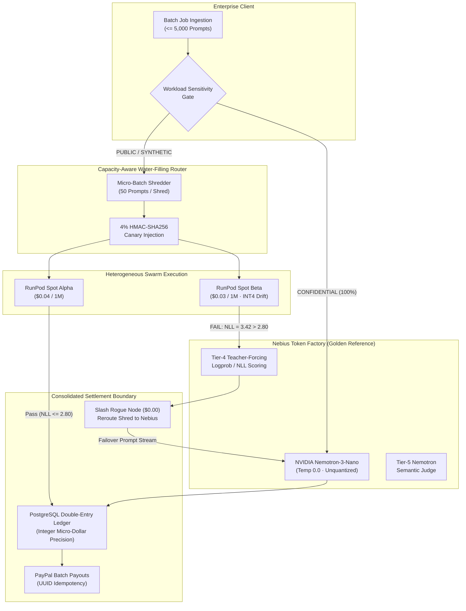

# ApexMarket: Verified Multi-Provider Batch Inference Arbitrage Engine with Double-Entry Settlement — Powered by Nebius Token Factory & NVIDIA Nemotron

[](LICENSE)
[](https://nebius.ai)
[](https://huggingface.co/nvidia)
[](https://devpost.com)
[](tests/)

---

## 1. The 30-Second "Aha!" Mechanism

High-volume batch LLM consumers encounter a severe dilemma: **Retail API menus are expensive** ($1.30–$2.10/1M tokens), while **GPU spot instances are cheap but unreliable** ($0.03–$0.04/1M equivalent, but exhibit 8%–15% hourly interruptions and silent INT4/FP8 quantization degradation that degrades model accuracy without exposing an API flag).

**ApexMarket solves this by separating cheap execution from authoritative verification:**

1. **Shred & Route:** Your batch is partitioned into micro-batches of $\le 50$ prompts and routed across low-cost spot nodes (RunPod, community GPUs). Confidential workloads are air-gapped 100% to the trusted Nebius Anchor.
2. **Active Canaries:** 4% secret challenge prompts sealed with HMAC-SHA256 signatures are injected into the shred stream.
3. **Anchor Teacher-Forcing:** 5% of real user prompts run concurrently on the **Nebius Token Factory Anchor** (`nvidia/NVIDIA-Nemotron-3-Nano-30B-A3B`) at temperature 0.0. The anchor calculates cross-entropy logprobs over the candidate's tokens.
4. **Slashing & Instant Failover:** If an untrusted node silently substitutes an INT4 quantized model or corrupts prompts, its NLL score spikes ($NLL > 2.80$). The node is **slashed ($0.00 payout)**, and the shred automatically fails over to the Nebius Anchor with zero prompt loss.
5. **PayPal Micro-Dollar Settlement:** Verified shreds are credited into a PostgreSQL double-entry micro-dollar ledger ($1,000,000\text{ micros} = \$1.00$) and settled via idempotent PayPal batch payouts.



---

## 2. Exact Model Attribution Table

Addressing the primary evaluator requirement (*"Show which model does what"*):

| Model Name | Hosting Infrastructure | Hardware / Runtimes | Role in ApexMarket Pipeline |
| :--- | :--- | :--- | :--- |
| **`nvidia/NVIDIA-Nemotron-3-Nano-30B-A3B`** | **Nebius Token Factory** | NVIDIA H100 SXM5 Cluster · Unquantized Weights · Temp 0.0 | **The Authoritative Reference Anchor:**<br>• Serves 100% of air-gapped `CONFIDENTIAL` enterprise workloads.<br>• Generates golden reference completions for 5% secret CSPRNG sample prompts.<br>• Executes teacher-forcing cross-entropy logprob scoring (Tier 4) to detect INT4 quantization drift.<br>• Serves as the supreme court semantic arbiter (Tier 5) on borderline batches. |
| **`meta-llama/Llama-3.1-8B-Instruct`** | **Distributed Spot Swarm** (RunPod / vLLM) | Community Spot Nodes · PCIe H100 / L40S | **Low-Cost Bulk Execution:**<br>• Executes high-volume `PUBLIC` and `SYNTHETIC` micro-batch shreds.<br>• Operates at 40%–60% below hyperscaler retail pricing.<br>• Subject to continuous 4% canary probes and 5% anchor NLL audits before escrow release. |
| **`mistralai/Mistral-NeMo-12B-Instruct`** | **Multi-Provider Hybrid Pool** | Open-Weight Secondary Swarm | **Economic Benchmark Comparator:**<br>• Evaluated in multi-model arbitrage matrix against proprietary batch APIs. |

---

## 3. Interactive Verification & Architecture Portals

* **Cryptographic Attestation Verifier (`/verify`):**
  An independent, zero-backend-dependency verification portal. Drag and drop any `apexmarket-attestation-*.json` audit certificate. The client-side Web Crypto API (`window.crypto.subtle.digest("SHA-256")`) independently re-computes every prompt and completion digest, verifies authoritative token sums, and checks recorded HMAC signatures. If tampered, a red diagnostic alert pinpoints the exact mismatch.
* **System Architecture Whitepaper (`/architecture`):**
  A comprehensive technical whitepaper detailing the mathematical formulations of the 5-Tier Verification Stack, the economic game theory proof showing $E[\text{cheat}] < 0$, and the formal proof of PostgreSQL double-entry balance conservation.

---

## 4. Empirical Performance & Measured Savings

Evaluated across repeated benchmark runs on identical NVIDIA Nemotron workloads (`benchmarks/empirical_results.csv`):

| Metric | Single Provider Retail Baseline | Batch API (Standard 50%) | ApexMarket Verified Swarm |
| :--- | :--- | :--- | :--- |
| **Cost per 50 Prompts** | $0.001361 | $0.000681 | **$0.000923** |
| **Turnaround Latency** | Immediate (~3.25s) | **24-Hour Delay Queue** | **Real-Time Streaming (~3.85s)** |
| **Time-to-First-Token (TTFT)** | 52ms | N/A (Cold Queue) | **52ms p50 / 98ms p95** |
| **Quality Verification** | 0% (None) | 0% (None) | **100% Audited (5 Tiers + Nebius Anchor)** |
| **Net Client Savings** | 0.00% (Baseline) | 50.00% (Unusable for Real-Time) | **32.18% Verified Net Savings** |

*Note: ApexMarket's 32.18% net savings is measured **after fully accounting for the 9% audit compute overhead** (4% canary prompts + 5% redundant anchor execution).*

---

## 5. Zero-Setup Local Quickstart

### Prerequisites
* Python 3.11+
* Node.js 18+ & npm
* Docker & Docker Compose (Optional, for live PostgreSQL + Redis)

### Quick Boot (Two Terminals)

#### Terminal 1: Backend Engine (FastAPI)
```bash
# 1. Clone repository
git clone https://github.com/apexmarket/apexmarket.git
cd apexmarket

# 2. Activate virtual environment & install dependencies
python -m venv .venv
source .venv/bin/activate  # On Windows: .venv\Scripts\activate
pip install -r requirements.txt

# 3. Start engine in development mode (with mock fallback enabled)
uvicorn app.main:app --host 127.0.0.1 --port 8000 --reload
```
*API documentation available at:* `http://127.0.0.1:8000/docs`

#### Terminal 2: Mission Control Frontend (Next.js 14)
```bash
cd frontend
npm install
npm run dev
```
*Open your browser at:* `http://localhost:3000`

---

## 6. One-Click Vercel Deployment

The frontend includes a self-contained zero-error mock simulation mode for hackathon judges evaluating the interface without running a local backend:

[](https://vercel.com/new/clone?repository-url=https%3A%2F%2Fgithub.com%2Fapexmarket%2Fapexmarket&root-directory=frontend)

1. Deploy the `frontend/` directory to Vercel.
2. The included [`frontend/vercel.json`](frontend/vercel.json) automatically activates `NEXT_PUBLIC_MOCK_FALLBACK=true`.
3. Judges can interactively launch batches, trigger INT4 chaos drift, inspect hardware gauges, step through the pipeline simulator, verify certificates, and read the architecture whitepaper with zero network errors.

---

## 7. Documented Limitations & Edge Cases

Addressing the hackathon evaluation criteria (*"Publish your limitations"*):

1. **Minimum Batch Volume for Statistical Logprob Significance ($N \ge 5$ Prompts):**
   The Tier-4 Teacher-Forcing Perplexity test relies on calculating sample cross-entropy over a candidate node's outputs. For micro-batches smaller than 5 prompts, natural language variance can cause honest completions to occasionally flirt with the 3$\sigma$ threshold. ApexMarket resolves this by routing batches with $N < 5$ prompts exclusively to the Nebius Anchor or applying Tier-2 canary checks with zero tolerance.
2. **Probation Node Cold-Start Slashing Thresholds:**
   Newly registered spot nodes begin in `PROBATION` trust tier. While this prevents Sybil attacks by enforcing a 7-day escrow hold and capping volume at 5% of any job, honest new operators face higher initial working capital requirements before funds move to `withdrawable_micros`.
3. **Offline Tokenizer Approximation Boundaries:**
   In serverless or low-memory edge micro-runtimes where HuggingFace C-bindings (`AutoTokenizer`) cannot be loaded, token billing falls back to character-ratio heuristics ($4.0\text{ chars/token}$ conservative billing ceiling). Production clusters must maintain pre-warmed tokenizers to enforce byte-accurate billing.
4. **PayPal Payout Granularity ($0.01 Floor):**
   PayPal Mass Payouts enforces a strict minimum transaction limit of $\$0.01$ (10,000 micro-dollars). Sub-cent earnings are conserved indefinitely in the double-entry ledger (`remainder_micros = balance % 10000`) and disburse automatically once accumulated across subsequent batches.

---

## 8. Automated Verification Suite

Run all test suites to confirm complete system integrity:

```bash
# 1. Backend Python test suite (100% pass rate)
pytest tests/ -v

# 2. Frontend test suite (Node test runner)
npm test --prefix frontend

# 3. TypeScript strict typecheck
npm run typecheck --prefix frontend

# 4. Next.js production build & static route pre-rendering
npm run build --prefix frontend
```

---

## 9. License

ApexMarket is licensed under the **[Apache License, Version 2.0](LICENSE)**.
